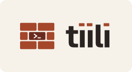

<p align="center">
  <picture>
    <source media="(prefers-color-scheme: dark)" srcset="docs/brand/logo/lockup-dark.svg">
    
  </picture>
</p>

<p align="center">
  <b>A tiling terminal for running many coding agents side by side.</b><br>
  macOS · Windows · Linux
</p>

---

https://github.com/user-attachments/assets/036a0249-6ed1-4265-a797-c3e10b6abc19

tiili tiles its terminals automatically and colours each one by its git repository, so ten agents across three
projects stay readable at a glance. *Tiili* is Finnish for brick: each terminal is a brick, the window is the wall.

## Features

- **Auto-tiling.** New terminals take their place on their own: fullscreen, side by side, 2×2, 3×3 and on.
  Drag dividers to resize, drag a pane's top edge to swap, reset to an even grid with one key.
- **Colour by repository.** Panes in the same git repository share a tint and a name chip. The chip follows
  `cd`.
- **Focus you can see.** The focused pane gets a brick line and a solid brick cursor; the rest dim slightly.
- **Copy and paste that work.** ⌘C/⌘V on macOS through a real Edit menu; Ctrl+Shift+C/V on Windows and Linux,
  so Ctrl+C still interrupts. Right-click works too.
- **Themes and fonts.** tiili Light and Dark plus Savi, Muratti, Koski and Laasti, Solarized, Gruvbox, Nord and
  Dracula. Any installed font, with ligatures, weights, line height and spacing.
- **Heynote scratchpad.** The note button next to **+** opens [Heynote](https://heynote.com) in a pane of its
  own: block-based notes with math and code blocks, saved as plain files in tiili's settings folder. Currency
  conversion fetches its rates from Heynote's server.
- **Small and native.** Tauri 2 and xterm.js: a real app per platform at around 10 MB, no Electron.
  No accounts, no sync, no telemetry.

## Install

Download the installer for your platform from [Releases](https://github.com/redfellow/tiili/releases):

| Platform | Installer |
| --- | --- |
| macOS | universal `.dmg` (Apple Silicon and Intel) |
| Windows | NSIS setup `.exe` (`tiili_<version>_x64-setup.exe`) |
| Linux | `.AppImage` or `.deb` |

## Shortcuts

| Action | macOS | Windows and Linux |
| --- | --- | --- |
| New terminal | ⌘T | Ctrl+Shift+T |
| Close terminal | ⌘W | Ctrl+Shift+W |
| Focus terminal 1–9 | ⌘1–⌘9 | Alt+1–Alt+9 |
| Move pane | ⌃⌘ + arrow | Ctrl+Alt+Shift + arrow |
| Reset grid | ⌃⌘0 | Ctrl+Alt+Shift+0 |
| Copy / Paste | ⌘C / ⌘V | Ctrl+Shift+C / Ctrl+Shift+V |
| Settings | ⌘, | Ctrl+, |

<details>
<summary><b>Windows: let the chip follow <code>cd</code></b></summary>

On macOS and Linux the pane follows your working directory by itself. On Windows it does so only when the shell
reports the folder with OSC 7 at each prompt; without that, the chip keeps the folder the pane started in.

PowerShell, in your profile (`notepad $PROFILE`):

```powershell
function prompt {
  $loc = $executionContext.SessionState.Path.CurrentLocation
  $osc7 = ""
  if ($loc.Provider.Name -eq "FileSystem") {
    $esc = [char]27
    $path = $loc.ProviderPath -replace '\\', '/'
    $osc7 = "$esc]7;file://${env:COMPUTERNAME}/$path$esc\"
  }
  "${osc7}PS $loc$('>' * ($nestedPromptLevel + 1)) "
}
```

cmd, once (it sets the `PROMPT` variable for your user):

```bat
setx PROMPT "$e]7;file://%COMPUTERNAME%/$P$e\$P$G"
```

</details>

## Build from source

Needs Node.js and Rust (via rustup), plus the [platform prerequisites](docs/packaging.md#prerequisites).

```sh
npm ci
npm run tauri dev     # run the app
npm test              # unit tests
npm run bundle        # installers for this OS, under src-tauri/target/**/bundle/
```

Signing, notarisation and icons are covered in [`docs/packaging.md`](docs/packaging.md).

## More

- [Concept](docs/concept.md): what tiili is, why it exists, and the technology choices.
- [Brand](docs/brand/README.md): logo, palette and design tokens.
- Specs live in [`openspec/specs`](openspec/specs); work is planned and built through härvääjä with OpenSpec.

## License

[MIT](LICENSE). The bundled fonts keep their own licences: see [`src/assets/fonts/LICENSES.md`](src/assets/fonts/LICENSES.md).

The Heynote pane bundles [Heynote](https://github.com/heyman/heynote) by Jonatan Heyman, built from its source by
`npm run heynote` into [`public/heynote`](public/heynote). Heynote is licensed under the MIT License with the
"Commons Clause" License Condition v1.0, which does not allow selling it: see
[`public/heynote/LICENSE`](public/heynote/LICENSE). Thank you, Jonatan, for making Heynote.
