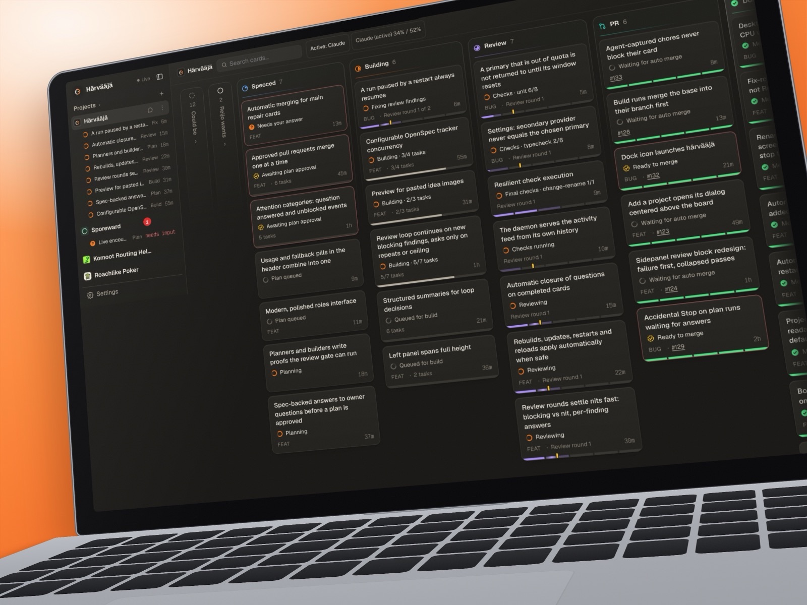

<p align="center">
  <picture>
    <source media="(prefers-color-scheme: dark)" srcset="docs/brand/logo/lockup-dark.svg">
    
  </picture>
</p>

<p align="center">
  <b>Every terminal a brick, the window a wall.</b><br>
  macOS · Windows · Linux
</p>

<p align="center">
  <a href="https://github.com/redfellow/tiili/releases/latest"><b>Download for macOS · Windows · Linux</b></a>
</p>

<p align="center">
  <a href="https://github.com/redfellow/tiili/releases/latest"></a>
  <a href="https://github.com/redfellow/tiili/releases"></a>
  <a href="LICENSE"></a>
</p>

---

https://github.com/user-attachments/assets/63479795-6228-4b6f-8b87-84d58127d348

tiili is a terminal that tiles itself. Open a shell and it fills the window; open more and they settle into a grid
on their own. Every pane is a real TTY running your own shell, tinted by the git repository it sits in, so a window
full of shells (servers, logs, editors, a coding agent or ten) stays readable at a glance. *Tiili* is Finnish for
brick: each terminal is a brick, the window is the wall.

## Features

- **Auto-tiling.** Fullscreen, side by side, 2×2, 3×3 and on. Drag dividers to resize, drag a pane's top edge to
  swap, reset to an even grid with one key.
- **Panes that tell you where you are.** Panes in the same git repository share a tint and a name chip that follows
  `cd`, and each title shows what is running, such as `bash` or `top`.
- **Copy and paste that work.** ⌘C/⌘V on macOS; Ctrl+Shift+C/V on Windows and Linux, so Ctrl+C still interrupts.
  Right-click works too.
- **Themes and fonts.** tiili Light and Dark, Savi, Muratti, Koski, Laasti, Solarized, Gruvbox, Nord and Dracula,
  previewed as you pick. Any installed font, with ligatures, weights, line height and spacing.
- **Heynote scratchpad.** The note button next to **+** opens [Heynote](https://heynote.com) in a pane of its own,
  with notes saved as plain files. Its currency conversion fetches rates from Heynote's server.
- **Small and native.** Tauri 2 and xterm.js, around 10 MB, no Electron. It reopens where you left the window, and
  its icon follows light and dark mode. No accounts, no sync, no telemetry. tiili checks GitHub once a day for a new
  version: one anonymous request, which you can turn off in Settings.

## Install

Get the installer for your platform from the [latest release](https://github.com/redfellow/tiili/releases/latest):

| Platform | Installer |
| --- | --- |
| macOS | `.dmg` for Apple Silicon (M1 and later) |
| Windows | `tiili_<version>_x64-setup.exe` |
| Linux | `.deb` or `.AppImage` |

On Linux:

```sh
sudo apt install ./tiili_*_amd64.deb
# or
chmod +x tiili_*_amd64.AppImage && ./tiili_*_amd64.AppImage
```

The builds are not signed yet, so the first launch takes one extra step:

- **macOS:** drag tiili to Applications and open it, then click **Open Anyway** in System Settings → Privacy &
  Security. If macOS says the app is damaged, run `xattr -dr com.apple.quarantine /Applications/tiili.app`.
- **Windows:** when SmartScreen says "Windows protected your PC", click **More info** → **Run anyway**.

## Shortcuts

| Action | macOS | Windows and Linux |
| --- | --- | --- |
| New terminal | ⌘T | Ctrl+Shift+T |
| Close terminal | ⌘W | Ctrl+Shift+W |
| Focus terminal 1–9 | ⌘1–⌘9 | Alt+1–Alt+9 |
| Move pane | ⌃⌘ + arrow | Ctrl+Alt+Shift + arrow |
| Reset grid | ⌃⌘0 | Ctrl+Alt+Shift+0 |
| Copy / Paste | ⌘C / ⌘V | Ctrl+Shift+C / Ctrl+Shift+V |
| Settings | ⌘, | Ctrl+, |

On Windows the name chip follows `cd` only when your shell reports its folder: see
[Windows: let the chip follow `cd`](docs/windows-cd.md).

## How it's made

tiili is planned, built and reviewed by coding agents on härvääjä, a board that runs each idea as a card through an [OpenSpec](https://github.com/Fission-AI/OpenSpec) change: plan,
build, checks, review, merge. The specs live in [`openspec/specs`](openspec/specs). härvääjä is in closed testing.

<p align="center">
  
</p>

To build tiili yourself, see [Building from source](docs/building.md). The [concept](docs/concept.md) explains why
tiili exists and the technology choices; the [brand](docs/brand/README.md) holds the logo, palette and design tokens.

## License

[MIT](LICENSE). The bundled fonts keep their own licences: see [`src/assets/fonts/LICENSES.md`](src/assets/fonts/LICENSES.md).

The Heynote pane bundles [Heynote](https://github.com/heyman/heynote) by Jonatan Heyman, built from its source by
`npm run heynote` into [`public/heynote`](public/heynote). Heynote is licensed under the MIT License with the
"Commons Clause" License Condition v1.0, which does not allow selling it: see
[`public/heynote/LICENSE`](public/heynote/LICENSE). Thank you, Jonatan, for making Heynote.
