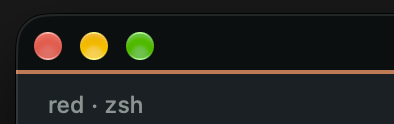

# Taller macOS top bar with centred window buttons

## Why
On macOS the top bar is 28px tall and the native window buttons nearly touch its bottom edge (see the attached screenshot), so the bar feels cramped. Reijo chose a 38px bar with the buttons centred in it.

## What Changes
- `src/styles.css`: `.top-bar[data-overlay]` height goes from 28px to 38px. The centred title's line-height (`.top-bar-title`, `13px/28px`) follows it so the title stays vertically centred. Check the left padding (76px) still clears the moved buttons.
- `src-tauri/tauri.conf.json`: add `"trafficLightPosition"` to the main window (macOS only in Tauri 2) so the close, minimise and zoom buttons sit vertically centred in the 38px bar. Start from about `{ "x": 14, "y": 19 }` and adjust so the 12px buttons are centred. Also keep the left inset in line with the x value.
- The Windows and Linux bar stays at 24px.

## Outcome
- macOS top bar
  - Now: 
  - After: a 38px bar, with the window buttons, title and action buttons vertically centred in it
- Windows and Linux
  - After: unchanged 24px bar

## Acceptance
- On macOS the bar is 38px tall, and the window buttons, title and right-hand buttons are vertically centred in it. The panes fill the space below it.
- The bar looks the same on Windows and Linux.

## Citations
- openspec/specs/window-top-bar/spec.md, Requirement: Window top bar (overlay beside the native buttons, no fixed height)
- src/styles.css `.top-bar[data-overlay]`, `.top-bar-title`
- src-tauri/tauri.conf.json `titleBarStyle: Overlay`

## Assumptions
- The right-hand buttons keep their size (22×20) and are only re-centred by the taller bar. Ruled out: making them bigger too.
- The title keeps its 13px font. Ruled out: a larger title.
